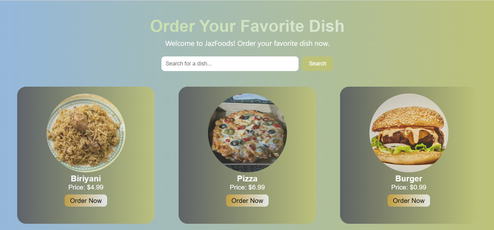
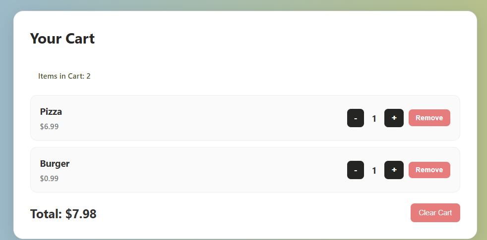
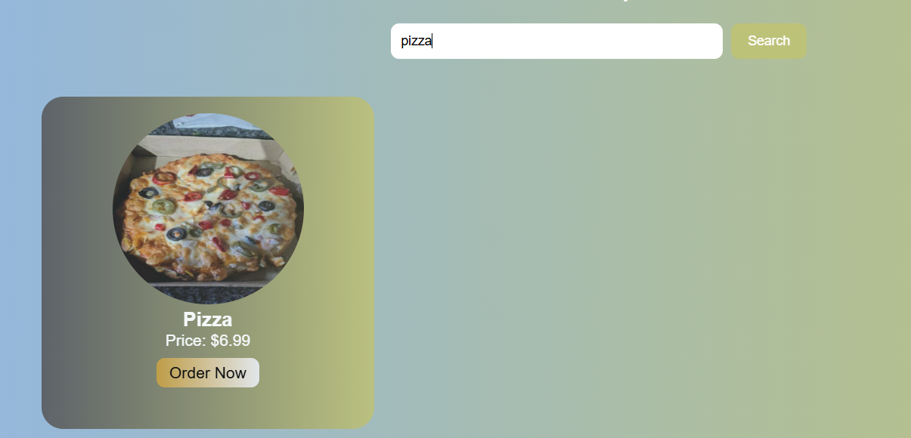

# Welcome to JazFoods

**JazFoods is a online food ordering service.**

# features

 **JazFoods website have following features:**
 
 - 1. User can view the menu and select items to order.

 

 - 2. User can add items to the cart and view the cart.

 

 - 3. It has a best design.

 

 - 4. It has search functionality to search for items in the menu.

 

# Installation

    1. Clone the repository to your local machine using the command:
    
     `git clone https://github.com/JazilJafar/Food.git`.
    
    2. Open the index.html file in your web browser to view the website.

- You can also see website live at [JazFoods](https://jaziljafar.github.io/Food/).

# Contributing

 *If you would like to contribute to JazFoods, please fork the repository and submit a pull request with your changes. We welcome contributions from the community! Team Open Source*

# License

 *JazFoods is licensed under the MIT License. See the LICENSE file for more information.*

# Technologies Used

 *JazFoods is built using HTML, CSS, and JavaScript.*

# Thank You

 *Thank you for using JazFoods! We hope you enjoy our Repository and please feel free to reach out to us with any feedback or suggestions.Also give a star to the repository if you like this*
 
